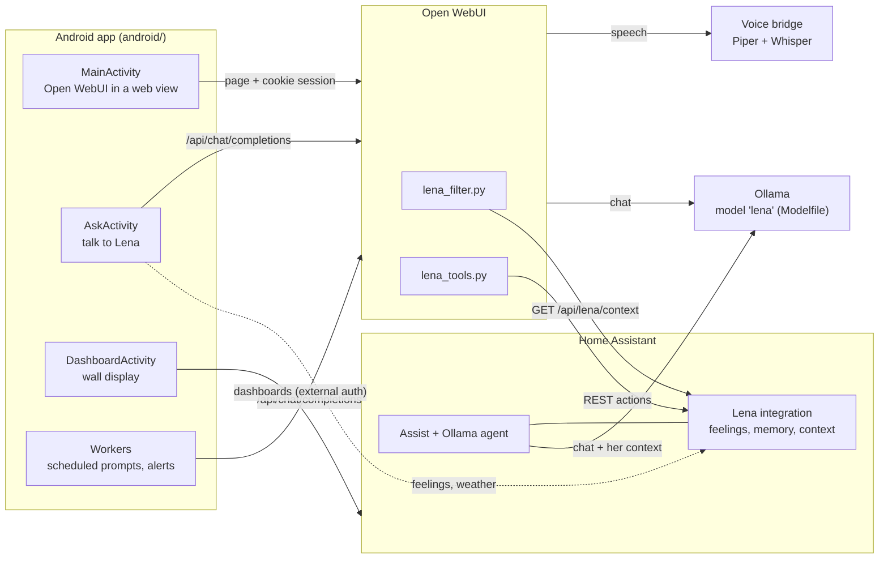
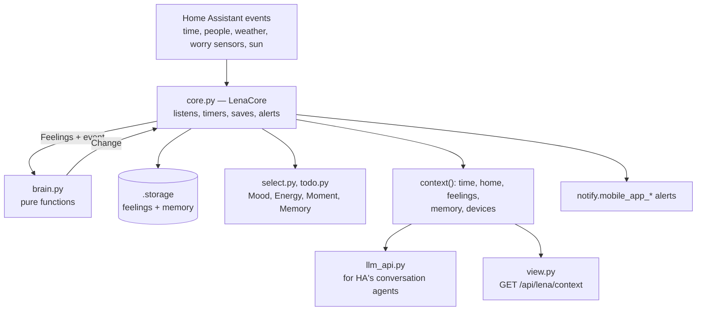
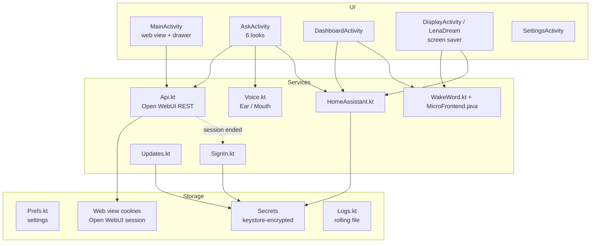
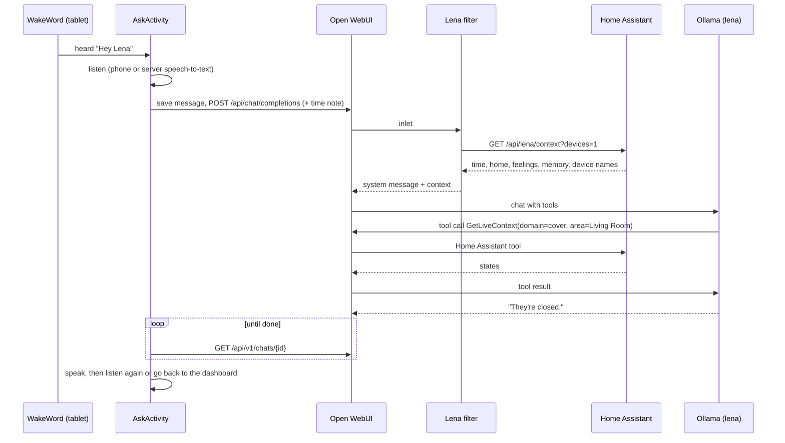

# Architecture

How Lena is put together and how data moves through it, for developers new to the project. For setting it up, start with the [README](README.md); for the repository layout and what must stay in step, see [Development](docs/Development.md); for the app's files, [App development](docs/app/Development.md).

## The idea in one paragraph

Lena is one character with one memory and one set of feelings, reached three ways: Home Assistant's voice assistant, Open WebUI, and an Android app. Her **character** is baked into an Ollama model, so every client gets the same Lena without repeating her instructions. Her **state** (feelings and memory) lives in Home Assistant, which already knows the house, the people and the time, and is handed to every client as text. The **app** is a thin native shell around Open WebUI plus the things a web page can't do (being the phone's assistant, a wake word, a wall display), and it talks only to your own servers.

## Components

| Component | Where | Owns |
|---|---|---|
| Her character | `ollama/Modelfile` | Who she is, how she talks, house rules. Put first in every conversation with a `MESSAGE system` line, which apps can't remove (a `SYSTEM` prompt would be replaced by any app's own). |
| Lena integration | `home-assistant/custom_components/lena/` | Her feelings, her memory list, her context text, her tools for Home Assistant's agents, alerts, and two HTTP views for the other clients. |
| Open WebUI filter and tool | `open-webui/` | Bringing her context into chats, and letting her remember, forget and react there. |
| Android app | `android/` | The phone and tablet experience. Holds no server state of its own beyond settings. |
| Voice bridge | `voice/bridge/` | Making Home Assistant's Piper and Whisper available to Open WebUI through an OpenAI-shaped API. |

## The Home Assistant integration

- **`brain.py` decides; `core.py` does.** Every rule about feelings (what an hour, a storm or a homecoming does to her) is a plain function from her current `Feelings` to a `Change`, with no Home Assistant imports. That keeps the rules readable in one place and testable offline: `tools/check.py` drives every event through it, and `core.py` only gathers inputs, applies the change, saves it and updates entities.
- **Feelings are data, not code.** `feelings.yaml` lists each mood, energy and moment with a description of how it sounds; the descriptions go into her prompt. Renaming or adding one needs no code change unless a rule refers to it by name (`tools/check.py` catches that).
- **Reasons are kept true.** A feeling carries a reason ("It's raining."), and the hourly check rewrites news into how things are, or drops reasons that stopped being true, while the mood itself lingers.
- **Everything is configured in the UI** (a config and options flow). Nothing needs YAML.
- **Context is text.** `context()` renders the time (with part of day and light/dark), who's home, her feelings and her memory as prompt-ready Markdown. Home Assistant's agents get it through the LLM API; Open WebUI and the app fetch it over HTTP. With `?devices=1` it adds the exact names of exposed devices, because Home Assistant's tools match names exactly.
- **Two views, both read-only and token-protected:** `/api/lena/context` and `/api/lena/media` (Home Assistant's media browser, for the app's photo frame, with Immich photos at preview size).

## Open WebUI

- **The filter** (`inlet`) runs before every request to the `lena` model: it fetches `/api/lena/context` (cached for a minute) and appends it to the system message. If Home Assistant is down she simply chats without it.
- **The tool** exposes `remember`, `forget` and `feel` to the model; each calls a Home Assistant action over REST, so the memory list and feelings stay in one place.
- Open WebUI keeps your chats, memories, notes, tools, knowledge and speech settings. The app reuses all of that through Open WebUI's own API rather than reimplementing it.

## The Android app

Design choices worth knowing before changing anything:

- **One sign-in, the page's own.** You sign in to Open WebUI inside the web view (password, LDAP or single sign-on, even behind a proxy like Authentik). The native features read the resulting `token` cookie and send it only to your server's origin, so there's no API key to manage. If the session ends, `SignIn.kt` can sign in again with details you chose to save, encrypted with an Android keystore key.
- **Answers are written server-side and followed by polling.** `Api.ask` saves your message and an empty reply into the chat, then asks Open WebUI's `/api/chat/completions` to answer it with the model's tools, exactly as the web page does. The app then polls the chat until the reply is marked done. That way an answer finishes even if you close the screen, and "Lena finished" notifications can pick it up.
- **One chat for talking to Lena.** The Ask screen always continues the pinned "Assistant Lena" chat, found by id and, failing that, by name, so it's the same conversation on every device. Half the model's context is given to it, newest first.
- **Notes for one request only.** The phone's time, "this will be read aloud", the lock-screen caution and a scheduled prompt's real text go in a system message with that request and are never saved into the chat.
- **The wall display signs Home Assistant in like the companion app.** It opens dashboards with `?external_auth=1` and answers the frontend's token requests through a message channel limited to your Home Assistant's origin. `assets/js/home_assistant.js` also hides Home Assistant's header and reports its views so Lena's bar can show them. Home Assistant's frontend isn't an API, so this is written to fail safe: if it breaks, the page just shows its own header.
- **The wake word runs entirely on the device.** `MicroFrontend.java` is a bit-exact port of the audio front end Home Assistant's voice satellites use (the build checks it against the C), feeding microWakeWord models through LiteRT. Detection follows ESPHome: settle for a second, average over a window, and require ESPHome's voice activity model to agree. Nothing is recorded or sent until she hears her name.
- **Background work is WorkManager plus inexact alarms**, so no special permissions are needed: scheduled prompts, following unfinished replies, the alert check and the widget refresh.
- **Settings and secrets stay on the device.** Settings are a private preferences file; tokens and passwords are AES-GCM encrypted with a keystore key; backups and device transfers are disabled for all app data.
- **Updates come from your own GitHub releases**, checked against the release's `SHA256SUMS`, the package name, the build number and your signing key before Android's installer sees them.

## A request, end to end

Asking "Are the curtains open?" by voice on the wall display:

## Trust boundaries

- The app talks only to the addresses you entered (Open WebUI, optional sign-in pages, optional Home Assistant) over HTTPS, plus GitHub's API when you check for updates. No analytics.
- Inside the app's web views, only those origins load; other links go to your browser, and anything else (`intent:`, `file:`, `javascript:`) is blocked. Script bridges exist only for their own origin and answer only the top frame; Lena's page scripts stop in frames, and on the wall display also on pages that aren't Home Assistant's frontend (apps proxied under `/api/`).
- Home Assistant's long-lived token and the Open WebUI filter's token are the main credentials; use a non-admin Home Assistant user for them.
- Her memory is added to prompts and shared with everyone who talks to her, so it must never hold secrets.

## Testing

| What | How |
|---|---|
| The rules, configuration consistency, versions, private data | `python3 tools/check.py` (offline, seconds) |
| The integration in a real Home Assistant | `.github/workflows/home-assistant.yml` (pytest-homeassistant-custom-component, oldest supported and latest) |
| The app compiles and the wake word front end matches the C | `.github/workflows/build.yml` |
| Everything with real voices, models and devices | By hand; see the test steps in each setup guide |
